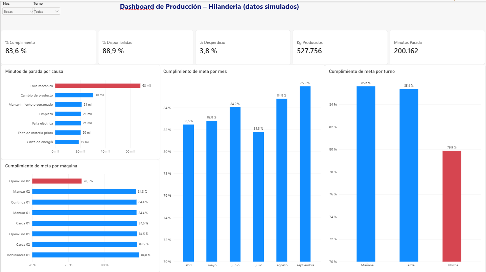
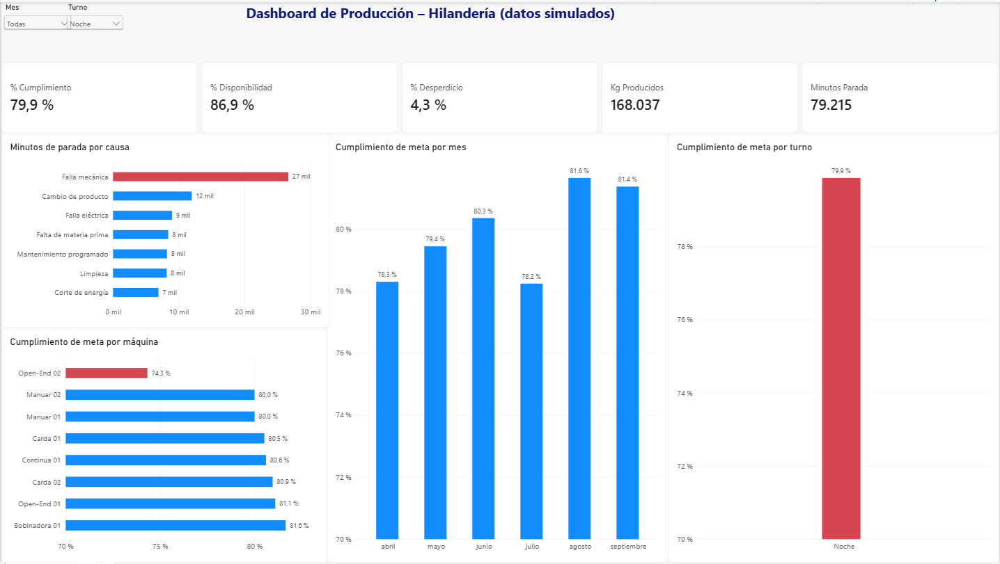

# 📊 Dashboard de producción – Hilandería (Power BI)

Tablero interactivo en Power BI que muestra el rendimiento de una planta de hilandería: cumplimiento de meta, desperdicio, disponibilidad de máquinas y causas de parada, con filtros por mes y por turno.

> **Nota:** todos los datos de este proyecto son **simulados**. No pertenecen a ninguna empresa real, y los patrones que se ven en el tablero fueron incluidos a propósito para el ejercicio.

---

## 🎯 Objetivo

Que un coordinador de producción pueda responder, de un vistazo:

- ¿Estamos cumpliendo la meta de producción?
- ¿Qué máquinas o turnos rinden peor?
- ¿Por qué se detienen las máquinas?
- ¿Cómo evolucionó el rendimiento mes a mes?

## 🖼️ Vista del tablero



**Con un filtro aplicado (turno Noche):**



## 📈 Indicadores principales

| Indicador | Valor (abril – septiembre 2026) |
|---|---|
| Cumplimiento de meta | 83,6 % |
| Disponibilidad de máquinas | 88,9 % |
| Desperdicio | 3,8 % |
| Kilos producidos | 527.756 |
| Minutos de parada | 200.162 |

## 🔍 Qué muestra el tablero (sobre los datos simulados)

- **Open-End 02** cumple solo el **76,8 %** de la meta, contra alrededor del 84,5 % del resto de las máquinas.
- El turno **Noche** rinde peor (**79,9 %**) que Mañana (85,6 %) y Tarde (85,4 %).
- La **falla mecánica** es la causa que más minutos de parada acumula (unos 68 mil, cerca de un tercio del total).
- **Julio** baja respecto de los otros meses (81,8 %) y desde agosto la tendencia mejora.

> Los ejes de los gráficos de cumplimiento empiezan en 70 % para que las diferencias se vean con claridad.

## 🧱 Cómo está armado

**Datos** (`produccion_planta.xlsx`, 3 hojas):

| Hoja | Contenido |
|---|---|
| `Maquinas` | 8 máquinas con su sector y la meta de kilos por turno |
| `Produccion` | Una fila por máquina, turno y día (kilos, meta, desperdicio, minutos de parada) |
| `Paradas` | Cada parada con su causa y su duración |

**Modelo:** las tablas `Maquinas`, `Calendario` y `Turnos` se relacionan con `Produccion` y `Paradas` (relaciones de uno a varios), lo que permite filtrar todo el tablero desde cualquier gráfico o segmentación.

**Medidas (DAX):**

```
Kg Producidos = SUM(Produccion[Kg_Producidos])
Meta Kg = SUM(Produccion[Meta_Kg])
% Cumplimiento = DIVIDE([Kg Producidos], [Meta Kg])
Kg Desperdicio = SUM(Produccion[Kg_Desperdicio])
% Desperdicio = DIVIDE([Kg Desperdicio], [Kg Producidos])
Minutos Parada = SUM(Paradas[Minutos])
% Disponibilidad = 1 - DIVIDE(SUM(Produccion[Minutos_Parada]), SUM(Produccion[Minutos_Programados]))
```

## 🚀 Cómo abrirlo

1. Instalá **Power BI Desktop** (gratis, solo para Windows) desde la Microsoft Store.
2. Descargá `dashboard_produccion.pbix` y `produccion_planta.xlsx`.
3. Abrí el `.pbix`. Si Power BI no encuentra el Excel, andá a **Transformar datos → Configuración de origen de datos** y elegí la ruta donde guardaste `produccion_planta.xlsx`.

## 📁 Archivos del proyecto

```
├── dashboard_produccion.pbix          # Tablero de Power BI
├── produccion_planta.xlsx             # Datos simulados
├── generar_datos_produccion.py        # Script que genera los datos simulados
├── captura_dashboard.png              # Captura del tablero
└── captura_dashboard_noche.png        # Captura con filtro por turno
```

## 🛠️ Tecnologías

Power BI · DAX · Python (pandas, openpyxl) · Excel

## 🔧 Posibles mejoras

- Conectar el tablero a una base de datos (SQL) en lugar de un archivo Excel
- Agregar una página de detalle por máquina
- Incluir metas por mes y comparación contra el año anterior
- Publicarlo con actualización automática de datos

---

## 🇺🇸 English summary

Interactive Power BI dashboard for a spinning mill: target attainment, scrap, machine availability and downtime causes, with filters by month and shift. Built on a star-style model (machines, calendar, shifts) with DAX measures. All data is simulated; patterns (an underperforming machine, a weaker night shift, a mid-year dip) were built in on purpose for the exercise.

---

## 👤 Autor

**Esteban González** · Estudiante de Ingeniería Electromecánica (UTN FRRe) · Análisis de datos y automatización de reportes
📍 Chaco, Argentina
🔗 [LinkedIn](https://www.linkedin.com/in/esteban-gonzalez-chaco)
